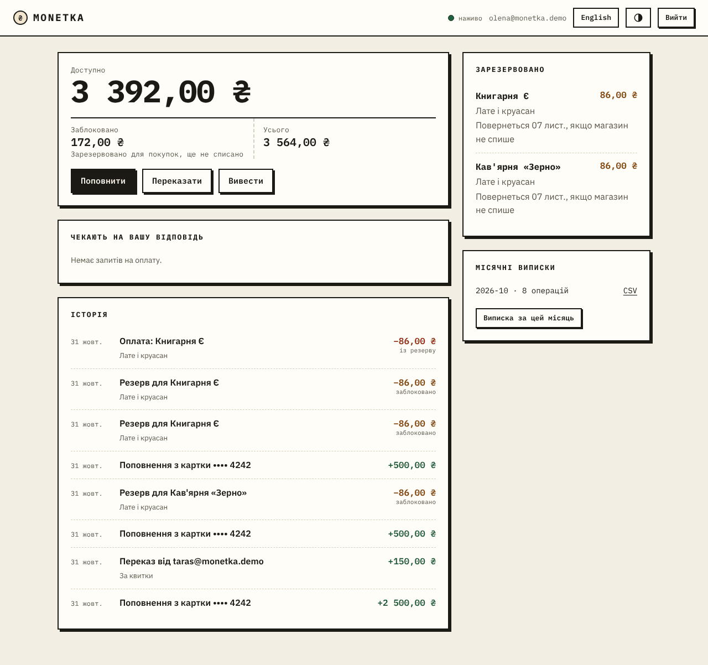
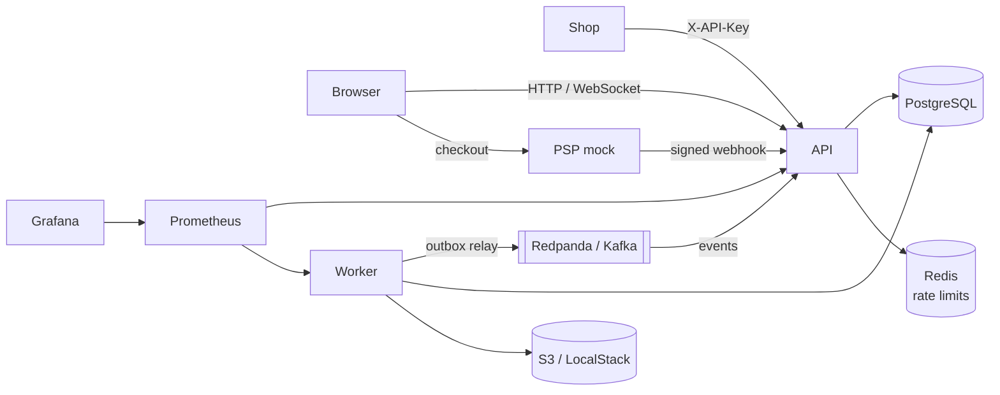
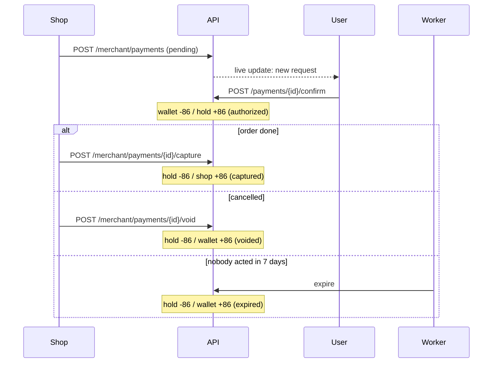
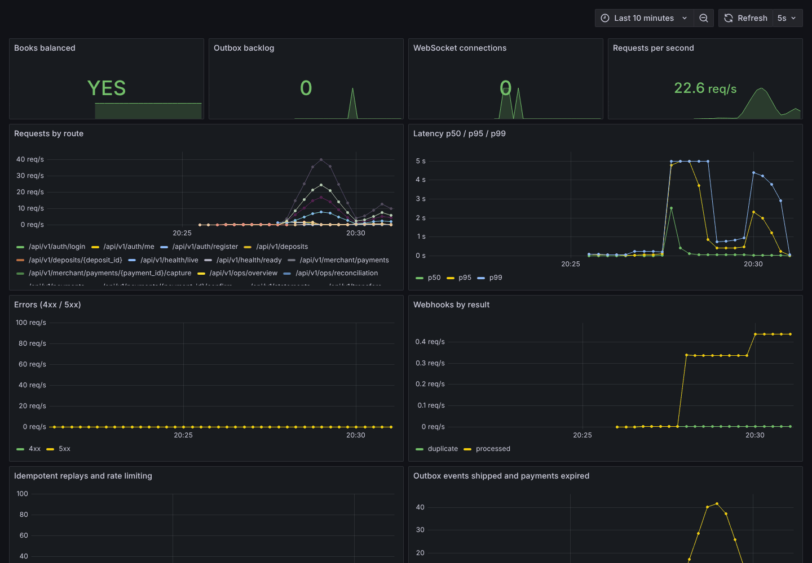
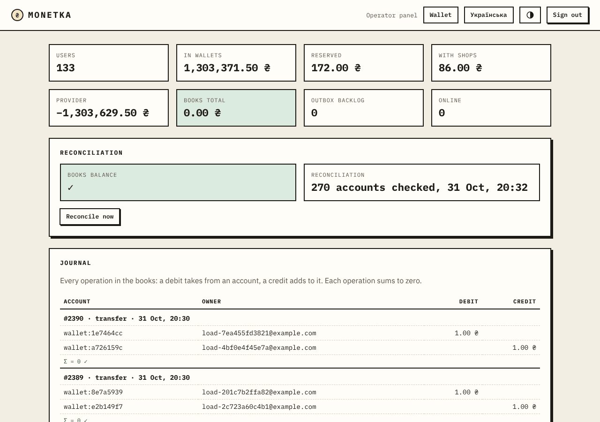
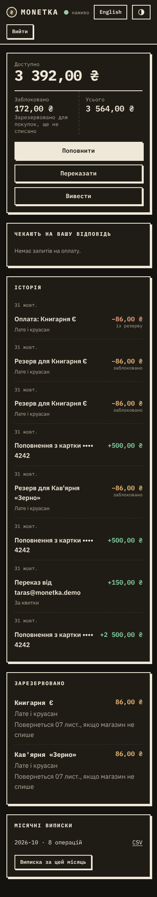
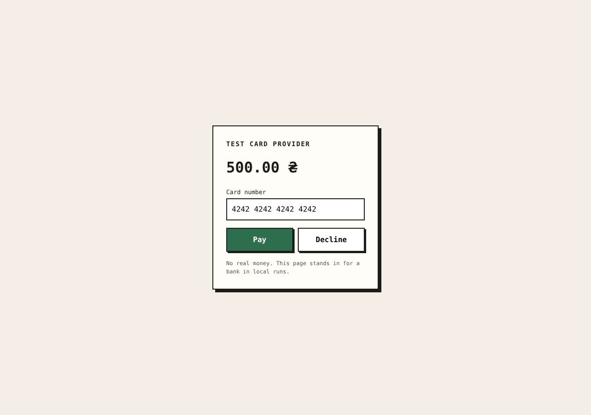

# Monetka

A digital wallet with shop payments, built on a double-entry ledger.
People top up from a card, send money to each other by email, pay in shops and withdraw.
Shop payments work in two steps, like card payments or bets: the amount is reserved first,
then charged when the order is done or released if it is not.

**[Live demo](https://zamotvlad.github.io/monetka/)** (runs in the browser with a mock
backend; the full system runs locally with one `docker compose up`).



## What it shows

| Problem | How Monetka handles it |
| --- | --- |
| Money must not appear or vanish | Double-entry ledger: every operation is postings that sum to zero, amounts are integer kopiyky |
| A retry must not charge twice | `Idempotency-Key` stored in PostgreSQL in the same transaction as the operation |
| Two requests spend the same balance | `SELECT ... FOR UPDATE` in a fixed order; tested with 100 parallel withdrawals |
| A shop charges, cancels and a deadline passes at once | Payment state machine plus a row lock: exactly one wins |
| Card provider sends webhooks twice, late or forged | HMAC signature with timestamp, event dedupe, final states never change |
| Events must match committed data | Transactional outbox relayed to Kafka (Redpanda) |
| Balances must be provably right | Scheduled reconciliation recomputes every balance from the entries |
| The system must be observable | Prometheus metrics, Grafana dashboard, JSON logs with request id |
| Statements | Monthly CSV in S3 (LocalStack locally), downloaded through presigned URLs |

## Architecture



Inside the API the code is layered ([ADR-0001](docs/adr/0001-layered-architecture.md)):

```
app/
  domain/        Money, ledger rules, payment state machine. No framework imports
  services/      use cases: ledger, wallet, payments, deposits, statements, reconciliation
  repositories/  queries; flush but never commit
  db/            models, session, unit of work
  api/           routes, schemas, errors, idempotency, rate limiting, websocket
  messaging/     outbox events, relay, Kafka producer and consumer
  integrations/  card provider contract, file storage
  workers/       outbox relay, payment expiry, reconciliation, monthly statements
  web/static/    the web app: plain HTML, CSS and JS modules
psp_mock/        a pretend card provider with a checkout page
```

### A shop payment, step by step



Design decisions are recorded in [docs/adr](docs/adr).

## Running locally

Requirements: Docker with Compose.

```bash
docker compose up --build -d
docker compose exec api python -m app.cli seed-demo
```

`seed-demo` creates users `olena@monetka.demo` and `taras@monetka.demo`, an operator
`ops@monetka.demo` (password `demo-password` for all) and a coffee shop, and prints the
shop's API key.

| What | Where |
| --- | --- |
| Web app | http://localhost:8000 |
| Demo shop (paste the API key) | http://localhost:8000/shop.html |
| Operator panel (sign in as ops) | http://localhost:8000/ops.html |
| API docs | http://localhost:8000/docs |
| Card provider mock | http://localhost:8001 |
| Grafana | http://localhost:3000 |
| Prometheus | http://localhost:9090 |

Other admin commands: `python -m app.cli create-merchant "Name"`,
`python -m app.cli make-operator email@example.com`.

## API in short

All routes are under `/api/v1`. Amounts are integers in kopiyky (`8600` = 86.00 UAH).
Errors look like `{"error": {"code": "insufficient_funds", "message": "..."}}`.

| Method | Route | Notes |
| --- | --- | --- |
| POST | `/auth/register`, `/auth/login` | JWT bearer token |
| GET | `/wallet`, `/wallet/history` | available, reserved, total; cursor pagination |
| POST | `/transfers`, `/withdrawals`, `/deposits` | require `Idempotency-Key` |
| GET/POST | `/payments`, `/payments/{id}/confirm`, `/payments/{id}/decline` | customer side |
| POST | `/merchant/payments`, `.../{id}/capture`, `.../{id}/void` | shop side, `X-API-Key` |
| POST | `/webhooks/psp` | signed by the provider |
| GET/POST | `/statements` | monthly CSV with a presigned link |
| GET/POST | `/ops/overview`, `/ops/journal`, `/ops/reconciliation` | operators only |
| WS | `/ws` | token in the first message, not in the URL |

## Tests

```bash
uv sync
uv run pytest
```

110+ tests. Domain rules are unit-tested, including a Hypothesis property test that random
transfers never create money or overdraw a wallet. Everything else runs against a real
PostgreSQL started by testcontainers: idempotent replays, 100 parallel withdrawals,
opposite transfers without deadlocks, capture/void races, webhook signatures and
duplicates, outbox relay with a failing broker, reconciliation catching a tampered balance.

CI runs Ruff, mypy in strict mode, the tests and a Docker build on every push.

## Load test

[Locust](loadtest/locustfile.py): each virtual user signs up, tops up through a signed
webhook, then checks the balance, reads history, sends transfers and withdraws.

```bash
uv sync --extra load
AUTH_RATE_LIMIT_PER_MINUTE=100000 docker compose up -d
uv run locust -f loadtest/locustfile.py --host http://localhost:8000 --headless -u 100 -r 20 -t 90s
```

100 users for 90 seconds, whole stack and Locust on one 4-core machine, one API process:

| Request | Count | Failures | p50 | p95 | p99 |
| --- | --- | --- | --- | --- | --- |
| GET /wallet | 3008 | 0 | 42 ms | 290 ms | 640 ms |
| GET /wallet/history | 1791 | 0 | 50 ms | 340 ms | 730 ms |
| POST /transfers | 1213 | 0 | 110 ms | 570 ms | 970 ms |
| POST /withdrawals | 594 | 0 | 110 ms | 610 ms | 930 ms |
| All, including sign-up | 7006 | 0 | 66 ms | 1.3 s | 6.2 s |

The tail comes from the first seconds, when 100 users sign up at once and bcrypt hashing
(slow on purpose) competes for CPU. After the run, reconciliation over 210 accounts found
the books balanced to zero.



## Stack

Python 3.12, FastAPI, Pydantic v2, SQLAlchemy 2.0 (async) with asyncpg, Alembic,
PostgreSQL 16, Redis, Redpanda (Kafka API) with aiokafka, LocalStack S3 with aioboto3,
Prometheus, Grafana, PyJWT, bcrypt, uv, pytest, Hypothesis, testcontainers, Locust, Ruff,
mypy, Docker Compose, GitHub Actions. Frontend: HTML, CSS, JavaScript modules.

## Screenshots

| Operator panel | Phone, dark theme | Card provider mock |
| --- | --- | --- |
|  |  |  |
